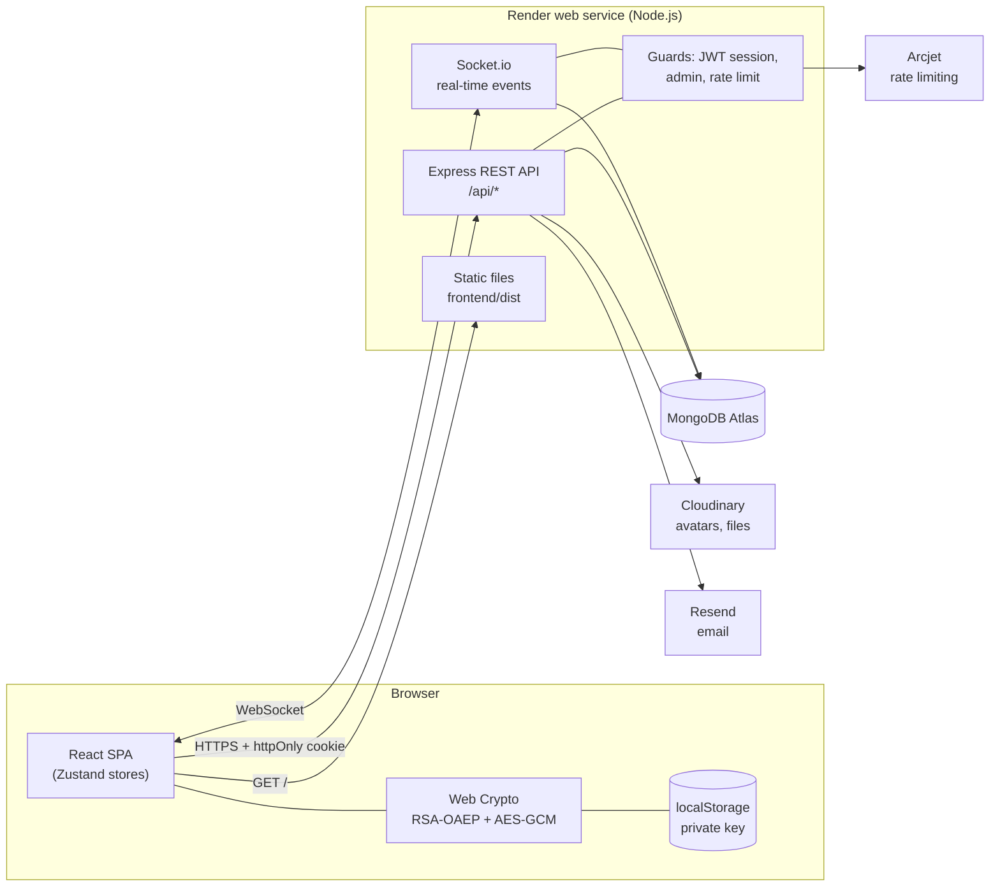

# NightWire

**A real-time messenger with end-to-end encrypted 1:1 chats, groups and an admin panel, built with React, Node.js, Socket.io and MongoDB.**

[](https://github.com/KostyaBalaban/Nightwire/actions/workflows/ci.yml)
[](LICENSE)

**Live demo: [nightwire.onrender.com](https://nightwire.onrender.com)**

| Demo login | Password |
| --- | --- |
| `demo@nightwire.demo` | `nightwire-demo` |

> The demo runs on a free plan: if nobody has used it for a while, the first load can take
> up to a minute. To see encryption in action, sign up with two accounts in two different
> browsers (or one normal + one private window) and message each other.

<!--
  SCREENSHOTS: save images to docs/screenshots/ and uncomment the block below.
  Capture at 1440×900 (or similar), dark theme, logged in as the demo account.

  1. chat.png        Main screen: chat list on the left, the conversation with Alice open,
                     showing a reply, reactions and the lock (encryption) badge in the header.
  2. realtime.gif    Two browser windows side by side: typing indicator, then the message
                     appearing instantly on the other side and the read receipt turning "read".
                     (ScreenToGif / Kap / LICEcap, ~10 s, under 5 MB.)
  3. groups.png      "NightWire Team" group open, with the group info panel showing roles.
  4. admin.png       Admin dashboard with the stats cards and the messages-per-hour chart
                     (log in with your own admin account).
  5. light.png       Optional: the same chat in the light theme / on a narrow mobile viewport.

<p align="center">
  
</p>
<p align="center">
  
</p>

| Groups | Admin panel |
| --- | --- |
|  |  |
-->

## About

NightWire is my graduation project: a full-stack messenger where messages, typing indicators,
read receipts and reactions are delivered in real time over WebSockets, and the text of
private chats is encrypted in the browser so the server only stores ciphertext.

## Features

**Messaging**

- 1:1 chats with **end-to-end encrypted text** (RSA-OAEP + AES-GCM, Web Crypto API)
- Real-time delivery, typing indicators, online status and "last seen"
- Read receipts: sent → delivered → read
- Replies, emoji reactions, editing, delete for me / for everyone, clear chat
- Images, video, audio and document attachments (up to 50 MB, stored on Cloudinary)
- Message search, unread counters, sound and browser notifications

**Groups**

- Create groups, join by invite code, leave
- Roles: owner, admins and members; promote, demote and remove members
- Group avatar and description, system messages for joins and leaves, group typing indicator

**Accounts and settings**

- Sign up / log in with a JWT stored in an httpOnly cookie
- Optional email verification with a 6-digit code (Resend)
- Profile with avatar and bio; dark and light themes, font size, minimalist mode
- Privacy: hide "last seen" and read receipts

**Moderation**

- Report messages (spam, harassment, forbidden content)
- Admin panel: dashboard (users, messages, online now, activity chart), block or delete users,
  grant admin rights, delete groups, review reports
- Rate limiting per IP (Arcjet)

## Tech stack

| Layer | Technologies |
| --- | --- |
| Frontend | React 18, Vite 6, Zustand, Tailwind CSS 3 + daisyUI, Framer Motion, Recharts, socket.io-client, Axios |
| Backend | Node.js 22 (ES modules), Express 4, Socket.io 4, Mongoose 8, JSON Web Tokens, bcrypt |
| Database | MongoDB Atlas |
| Services | Cloudinary (media), Resend (email), Arcjet (rate limiting) |
| Quality | Jest, Vitest, Playwright, ESLint 9, Prettier, GitHub Actions |
| Hosting | Render (one web service for the API, WebSockets and the static frontend) |

## Architecture



- **One origin.** In production Express serves the built React app, the REST API and Socket.io
  from the same domain, so the session cookie is `SameSite=Strict` and no CORS setup is needed.
- **REST for state, sockets for events.** Messages are created through the REST API, then
  pushed to the recipient's socket. Typing, read receipts and presence go over sockets only.
- **Socket authentication.** The socket handshake is authenticated with the same httpOnly JWT
  cookie as the API; the user id is never taken from the client.
- **Backend layout.** Each feature is a module with `router → handlers → service → schema`
  (`auth`, `messaging`, `groups`, `reports`, `admin`).

## How the end-to-end encryption works

1. **Key generation.** On sign-up the browser generates an RSA-OAEP 2048-bit key pair with the
   Web Crypto API. The **public key** is uploaded to the server; the **private key** is stored
   only in this browser's `localStorage` and never leaves the device.
2. **Sending.** For every message the sender's browser generates a random AES-256-GCM key,
   encrypts the text with it, then encrypts that AES key with the recipient's RSA public key.
   The server receives and stores one base64 blob: the encrypted AES key, the IV and the
   ciphertext.
3. **Receiving.** The recipient's browser decrypts the AES key with its private key, then the
   text. Real-time pushes and edits are decrypted the same way before being shown.
4. **Your own messages.** RSA encrypts for the recipient only, so the sender keeps the
   plaintext of messages they sent in a local cache to display their own history.

A lock badge in the chat header shows when a conversation is encrypted. If either side has no
key (for example the shared demo account), messages are sent as plain text.

## Limitations and trade-offs

- **No server-side search of encrypted messages.** Search runs on the server, which only has
  ciphertext, so it finds messages from unencrypted chats only. Full search would need a
  client-side index.
- **Keys are tied to one browser.** The private key lives in `localStorage`. Logging in on
  another device, in a private window or after clearing site data means older encrypted
  messages cannot be decrypted there. *Settings → Reset encryption keys* creates a new pair
  for new messages; old ones stay unreadable. There is no key backup or multi-device sync yet.
- **What is not encrypted.** Group chats, attachments (images and files on Cloudinary),
  reactions and metadata (who talks to whom and when) are visible to the server.
- **Trust in the server for public keys.** Keys are not verified out of band (no safety
  numbers), so a malicious server could substitute a public key.
- **Rate limiting.** Arcjet allows about 20 requests per 10 seconds per IP (burst 50). Many
  users behind one shared IP (an office network) could hit the limit.
- **Free hosting.** The Render free plan sleeps after 15 minutes of inactivity (cold start up
  to a minute), and Cloudinary's free plan has lower per-file limits than the app's 50 MB.
- **Shared demo account.** Anyone can write in the demo chats; the data is reset with
  `npm run seed`.

## Running locally

**Requirements:** Node.js 20+ (22 recommended), a MongoDB database (a free
[MongoDB Atlas](https://www.mongodb.com/atlas) cluster or a local `mongod`).

```bash
git clone https://github.com/KostyaBalaban/Nightwire.git
cd Nightwire

# backend: http://localhost:3000
cd backend
cp .env.example .env        # fill in MONGO_URI and JWT_SECRET at least
npm install
npm run dev

# frontend: http://localhost:5173 (in a second terminal)
cd frontend
cp .env.example .env
npm install
npm run dev
```

Open http://localhost:5173 and sign up. **The first account becomes the admin.** Then
optionally load the demo data:

```bash
cd backend && npm run seed   # demo@nightwire.demo / nightwire-demo + contacts, chats, groups
```

To run the production build locally (one port, like on Render): `npm run build` at the
repository root, then `cd backend && NODE_ENV=production npm start` and open
http://localhost:3000.

## Environment variables

**Backend** (`backend/.env`, see [`backend/.env.example`](backend/.env.example)):

| Variable | Required | Description |
| --- | --- | --- |
| `MONGO_URI` | yes | MongoDB connection string, including the database name |
| `JWT_SECRET` | yes | Long random string used to sign session tokens |
| `PORT` | no | HTTP port, default `3000` |
| `NODE_ENV` | no | `production` enables secure cookies and live rate limiting |
| `CLIENT_URL` | no | Frontend origin for CORS in development (`http://localhost:5173`) |
| `CLOUDINARY_CLOUD_NAME`, `CLOUDINARY_API_KEY`, `CLOUDINARY_API_SECRET` | for uploads | Avatars and attachments |
| `RESEND_API_KEY` | no | Without it, emails are skipped |
| `EMAIL_FROM`, `EMAIL_FROM_NAME` | with Resend | Sender address and name |
| `ARCJET_KEY` | no | Without it, rate limiting is off |
| `ARCJET_ENV` | no | `development` for local runs only |
| `DEMO_PASSWORD` | no | Password for the seeded demo accounts, default `nightwire-demo` |

**Frontend** (`frontend/.env`):

| Variable | Description |
| --- | --- |
| `VITE_API_BASE_URL` | Backend URL in development (`http://localhost:3000`). Leave empty when the backend serves the frontend (production). |

## Project structure

```
backend/
  server.js               entry point: checks env, connects to MongoDB, starts HTTP + Socket.io
  scripts/seed-demo.js    demo data (npm run seed)
  src/core/               Express app, database connection, Socket.io (auth, presence, typing)
  src/guards/             JWT session, admin-only, rate limiting
  src/modules/            auth, messaging, groups, reports, admin
                          (*.router.js → *.handlers.js → *.service.js, *.schema.js)
  src/mailer/, src/vault/ Resend and Cloudinary wrappers
  src/__tests__/          Jest unit tests
frontend/src/
  core/                   App and routes
  screens/                auth, chat, groups, settings, profile, admin
  widgets/                reusable components (message bubble, modals, reactions, …)
  store/                  Zustand stores: session, chat, groups, preferences
  lib/                    Axios, Socket.io client, crypto (E2E)
  hooks/                  socket events, sounds
  __tests__/              Vitest unit tests
e2e/                      Playwright end-to-end tests
docs/DEPLOY.md            deployment guide (Render + MongoDB Atlas)
render.yaml               Render Blueprint
```

## Tests

| Suite | Command | What it covers |
| --- | --- | --- |
| Backend unit (Jest) | `cd backend && npm test` | Group creation, invite codes and roles; message creation, edit permissions and reactions; password hashing |
| Frontend unit (Vitest) | `cd frontend && npm test` | Key generation and encryption round-trip; unread counters and read state; edits and replies never sending plaintext of encrypted messages |
| End-to-end (Playwright) | `npm run test:e2e` | Sign-up and login; two users chatting in real time in two browsers, with a check that the server stores only ciphertext; creating a group and joining it by invite code |

The end-to-end tests start the real backend with an in-memory MongoDB, so they need no
external services. Install the browser once with `npx playwright install chromium`.

`npm test` at the root runs both unit suites; `npm run lint` and `npm run format:check` run
ESLint and Prettier. GitHub Actions runs lint, unit and end-to-end tests on every push and pull
request.

## Deployment

The app is deployed as a single Render web service from [`render.yaml`](render.yaml), with
MongoDB Atlas as the database. Step-by-step guide: [docs/DEPLOY.md](docs/DEPLOY.md).

## Roadmap

- Encrypted key backup with a passphrase, so the same account works on several devices
- End-to-end encryption for group chats (sender keys) and for attachments
- Client-side search index for encrypted conversations
- Safety numbers to verify a contact's public key
- Pagination of long chat histories
- Voice messages and Web Push notifications
- Migration to TypeScript

## License

[MIT](LICENSE)
